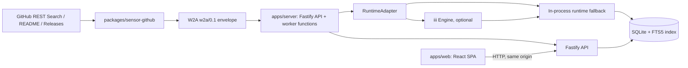

# 机会捕手详细设计与 MVP 实现计划

版本：0.26（2026-10-27，评估故障的有界分项降级）
对应 PRD：[PRD.md](./PRD.md)  
目标：在本地运行 GitHub 项目发现到验证记录闭环；产品完整方向、已实现范围和后续设计必须分开阅读

## 1. 设计目标

### 1.1 目标

- 用真实、可追溯的来源产生持续信号。
- 让每个判断都能回到原始数据。
- 让新增数据源不改变下游分析逻辑。
- 让采集、分析、通知可以重试、暂停和观测。
- 先支持一个用户稳定使用，再扩展多用户和云端部署。

### 1.2 非目标

- 不把 World2Agent 当作数据权限或万能爬虫。
- 不把 iii 当作不可替换的业务数据库。
- 不在第一阶段建立全量 GitHub 镜像。
- 不用模型生成内容替代原始证据。
- 不在第一阶段引入独立图数据库和复杂分布式系统。

## 2. 总体架构

需求研究的评估层采用两级边界：完整评估只在模型正常结束且通过证据校验后进入反方审查；Codex/OpenCode 明确超时或未完整结束时，复用已采集材料，最多按两个项目分别调用模型。分项调用只能输出逐能力证据，路径固定为待验证 `adapt`、约束为 `unknown`，不进入审查和推荐。每个项目独立失败，不能污染其他项目；父任务快照不可变。引用必须在发给模型的该项目摘录中逐字唯一匹配，来源摘录有上限而持久化原文不截断。

```text
Manual / persisted due time -> iii scan function -> GitHub REST Search (five tracks)
        |
        v
GitHub sensor (README + latest Release + public Issue samples; on-demand repository docs)
        |
        v
World2Agent w2a/0.1 signal
        |
        v
iii Engine -> SDK worker functions (explicit local mode available)
        |
        +--> validate + deduplicate + persist
        +--> deterministic project scoring and capability rules
        +--> iii analyze -> capability catalog -> complementary groups (<=4)
                         -> deep evidence (<=12 projects) -> proposal -> citation checks -> opposing review gates
        |
        v
SQLite (WAL + FTS5 index)
        |
        v
Fastify API --> React workbench + Markdown research export
```

已实现的发现支路：`GET /api/v1/discovery/brief` → 最近首次收录的最多 200 个项目 + 每项目最近两次观察 → 描述关键词与逐字摘录 → React 发现工作台。该接口只读，不经过模型，不写机会，不依赖机会分析是否产生结果。项目详情接口同时返回相同的 `discovery` 线索，项目列表可按中文能力标签搜索。

发现展示规则位于 `apps/server/src/discovery.ts`，覆盖地图、Office、媒体、数据连接、公开数据 API、分析、浏览器、采集、评审、知识管理、编排、检索与 Agent 等 14 个方向。优先匹配描述；描述没有命中时仅检查 README 摘录前 6,000 字符，作为待识别材料保存。README 单独出现关键词可能是赞助、依赖或贡献工具，不进入默认能力池。描述中有课程/教程/资料迹象时进入资料视图。规则遗漏与误报仍可能存在，均保留来源与原文，不声称执行验证或语义确认。

默认浏览先取每个主要能力方向的最新收录项目，再补同类；用户可切换本轮首次收录、版本标签变化、公开问题、资料与待识别，结合方向和全文线索筛选。能力多标签计数可重叠，三个项目类型计数互斥。没有结果时提供有区分的空态，选择最多三个项目后通过重复 `project` 查询参数预填既有研究表单；只有显式提交研究才调用模型。

首页按“区域直达链接 → 必要采集异常 → 能力发现 → 工作区统计/持续关注/最近判断 → 分析简报”展示。`#discovery/#monitoring/#research-notes` 使用原生锚点和滚动留白，能力区加载/失败时也保留锚点。`ResearchNotebook` 的compact模式仅将完整结论、下一步及依据收进原生details，决定、标题、作者、市场验证边界和来源变化警告保持可见；完整工作台不折叠，不改变任何持久化内容、引用或修订关系。

`apps/web/src/CollectionNotice.tsx` 复用 `dashboard`/`monitoring` 查询缓存，只读取现有扫描和关注状态。failed/partial扫描、failed/partial关注、有效限流时间及状态查询错误触发首页提示；状态恢复后移除。没有独立健康探测、自动重分析或新API/schema。预览验收 `scripts/verify-home-priority.mjs` 通过只读代理加载真实资料，异常状态由隔离浏览器夹具覆盖；真实刷新观察脚本 `scripts/observe-live-refresh.mjs ID` 会写实际工作区，不能当普通测试运行。量测与实际502保留性结果见[首页改进报告](research/2026-10-21-home-priority.md)。

观察对比由 SQLite 窗口查询批量取得最近两条记录；保留各自时间与 Star/Fork 差值。仅两个非空版本标签不同时显示标签变化；未知变已知不算新发布，缺基线不推断增长，现有发布仍提供来源。当前观察表没有逐字段抓取成功标记，因此这一规则偏保守；README 失败时可能保留历史摘录，展示的时间是档案观察时间，不冒充摘录重新获取时间。首次收录与最近一次有结果且已结束的扫描时间区间比对，独立展示仓库创建时间。

旧六类规则能力仍用于显式 `rules` 原型模式，技术线索分保留在档案供检查。发现支路不使用该分数，也不改变模型输入、缓存或六项机会审查门槛。仓库存储查询在首次收录时间相同时以名称稳定排序，避免数据库旧分数与接口重新计算分数不一致影响显示。

已实现的技术补证支路：项目详情 → `POST /api/v1/projects/:id/documentation` → iii `collect-evidence` → GitHub Contents API → `github.documentation.observed` W2A signal → SQLite `projects.documentation_json`（schema 7）及原始 signals → 下次显式机会分析。该操作不触发模型调用，与扫描、分析共享互斥槽。

补证可指定最多两个同仓库文本文件；路径留空时读取 README，提取 Markdown 行内链接，优先 CLI/API/MCP、规范与用法，最多读取两个文件。不递归，也不访问外部文档站；仅支持 `.md/.mdx/.rst/.txt`，单文件上限 512 KB，总请求预算 60 秒。图片、代码块、外部仓库链接、绝对路径和越界路径不会成为文档请求。自动发现不解析所有 Markdown/HTML 语法，未命中时可指定路径。

请求可传可选 `ref`（tag、分支或 commit，最长 160 字符，拒绝网址、越界和非法 Git ref）。指定时先用同仓库 Commits API 解析为完整 `commitSha`，再以该提交读取 README 和文件；一次采集只解析一次，不跟随移动 tag。每份新文件及报告分别保存 `ref/commitSha`，链接指向完整提交。解析失败返回 404/429/422/502 等明确错误，不读取 HEAD、不写新信号，旧快照不变。路径读取部分失败仍保存警告；被保留文件保持自己的原版本，报告的请求版本不能代替文件版本。

每份文档保留路径、Git Blob SHA、采集时间、最多 8,000 字符的原文摘录和仓库链接。未传 ref 时延续默认分支行为：`blob/HEAD` 是可变链接，Blob SHA 不冒充提交 permalink。项目最多留存六份，同一路径保留当前一版；研究判断已保存的原文快照不被替换。模型实际接收最近排列的两份未失效文档，目录及深读携带文件自身版本；深读说明固定提交的文档自述不证明发行、安装运行或接口兼容性。版本和提交变化进入输入 hash；历史无版本字段时维持原结构、旧 HEAD 引用 notice 和提示版本 v4.3，不批量失效旧缓存。JSON 可选字段无需 schema 迁移。失败路径的旧文档保留但标记 stale、排除分析；未尝试路径保留原状态。README 发现请求整体失败时接口报错，旧快照不变。页面、研究材料与判断导出展示相应来源边界。

提示版本 `deepseek-opportunities-v4.4` 延续 documentation 引用同项目精确 `documentPath` 的要求，并增加评论的 `commentId` 核验，程序只在实际发送的摘录中做连续原文核验，并由本地数据派生 URL、时间、路径与 SHA，写入机会和 Markdown 导出。文档内容、SHA、失效状态、有效讨论内容及 Issue 作者变化影响输入 hash。Issue 采集保留 `authorLogin/authorAssociation`，模型与页面区分维护方规划、外部问题与身份未知；同一作者多个 Issue 不能当作独立客户样本，NONE 也不等于已确认客户。旧样本未采集到作者登录名时保持未知，不补造身份。

定向研究支路：机会页选定 2～3 个已采集项目及研究问题 → `POST /api/v1/analysis` 的可选 `focus` → iii `analyze-opportunities` → 仅选定项目的有效证据 → 提案、原文核验、反方六项检查 → 独立研究范围的候选与运行记录。跳过目录选择，研究问题作为不可信待验证数据传给两个角色，不作为系统指令或可引用证据。自由发现路径保留。

研究材料由 `apps/web/src/ResearchMaterials.tsx` 展示：组件原始描述、许可证标识与下一步检查，并提供最近两份未失效补充文档的前 1,200 字符、Blob SHA 与采集时间。问题起点显示已采集的完整正文片段、作者登录名/关系、更新与采集时间及当前讨论链接。起草按钮只填入可编辑问题，不提交请求；项目档案通过 `/opportunities?project=ID&issue=NUMBER` 带入问题，多个组件继续使用重复 `project` 参数。

`focus` 现支持可选 `originIssue: { projectId: string; issueNumber: number }`，与 `projectIds`（2～3 个不同项目）、`question`（去首尾空白后 12～1,200 字符）一起由 `researchFocusSchema` 校验。Issue 编号必须为正整数，所属项目必须已被选择。API 和 provider 都通过 `researchOriginAvailable` 检查所选项目确有这条已采集 Issue；缺失时 API 返回 400 `unknown_origin_issue`，不启动付费任务。前端失效深链明确报错并禁用提交；移除起点所属组件会清空起点，也可显式切换到无 Issue 模式。

有起点时，在提案与反方提示中追加约束，并在反方请求前检查每个候选的 `problemEvidence` 是否包含同项目、同编号的引用，再执行既有逐字原文核验。缺引用、引用其他 Issue 或伪造引文的候选被淘汰；是否真正回应障碍仍由反方检查与人工复核决定，程序不能从引用存在推断语义成立。既有六项检查不放宽。

规范化研究范围保留 `originIssue`，因此它参与输入 hash、缓存及机会范围标识，换起点会形成独立研究。起点随既有 request/result JSON、提案 checkpoint、历史记录和 Markdown 保存，起点功能自身无需迁移；讨论快照在 schema 9、prompt v4.3 引入；研究判断使当前 schema 为 10，prompt 保持 v4.3。旧分析保留，不自动重放付费请求。缓存查找返回最近成功运行，`reusedFrom` 可指向另一次复用记录；该次 usage 为 null，最初实际调用的用量保留在原始运行中。

问题驱动的池外组件支路位于 `apps/server/src/components.ts` 与 Web `ComponentFinder.tsx`。`POST /components/search` 接收 2～256 字符的 GitHub query，附加 `is:public`，仅调用一次 Repository Search，按 GitHub 默认相关性预览最多六个结果，不读取详情、不写 SQLite，不自动添加创建窗口、Star 排序或商业推荐。返回总数、结果是否不完整、采集时间、项目自述、语言、SPDX 标识、归档/Fork 和本库是否已收录；再次过滤上游意外返回的私有项目。GitHub Search 的文本范围与相关性会漏掉项目，结果不代表全量方案。

`POST /components/import` 接收 owner/repository 或 HTTPS GitHub 仓库首页（兼容 `.git`），本地解析成名字，再固定调用 GitHub API，不访问输入 URL。拒绝外部域名、凭证、端口、分支路径与查询参数；总体 60 秒内读取仓库元数据，确认不是私有仓库后复用 README/Release/有限 Issue 的采集流程。每字段成功标记传入既有存储，失败字段保留旧资料并返回 warning。项目渠道合并 `按需收录`，生成并校验原有 `github.repository.observed` W2A 信号、保存原始元数据及观察；不创建扫描记录、不改扫描到期时间、不触发机会分析或市场状态变化。数据库无迁移。

搜索与收录均通过 iii `collect-evidence` 执行，同扫描、文档补证和模型分析使用同一任务互斥槽。GitHub 限流、查询错误、资源不可见和其他上游错误分别返回 429、422、404、502；未知错误仍走全局处理器。前端操作期间禁用提交，收录成功先载入真实档案，再选择第一个空组件位；最多三个组件，满位需显式移除。原问题绑定不随补组件丢失。

新项目从空仓库开始，不继承已废弃原型的代码。MVP 采用本地优先的单机架构：一个 Node.js 应用进程同时承载 Web/API 与 worker 函数、一份 SQLite 数据库、一个 React 单页应用和独立 iii Engine。默认模板配置 Engine，已配置时禁止静默回退；主动清空 `III_URL` 才使用进程内运行时。模型默认 `LocalCliTransport`：OpenCode CLI 2.x 的已核价免费候选 → 用户现有 Codex CLI 模型配置。Codex 单独记录来源及费用边界；仅显式 DeepSeek 模式使用 HTTP API。模型 transport 与 iii 执行调度分离。先不引入 PostgreSQL、对象存储、向量数据库或 Kubernetes；数据访问经过 storage 接口。

## 3. 运行时分工

### 3.1 World2Agent

World2Agent 作为跨来源信号协议和传感器边界：

- `sensor-github` 负责调用 GitHub 实际接口。
- 传感器输出 `w2a/0.1` envelope。
- 下游只依赖标准事件和来源数据，不依赖某个平台的响应格式。
- 后续可增加 Hacker News、npm、PyPI 等 sensor。

World2Agent 不负责：

- 获取 GitHub Token 或平台权限。
- 绕过平台限制。
- 自动完成跨来源图谱。
- 解释商业价值。

### 3.2 iii

当前注册 `opportunity-radar::ping`、`opportunity-radar::scan`、`opportunity-radar::analyze-opportunities` 和 `opportunity-radar::collect-evidence`。适配器将构造参数或 `III_NAMESPACE` 显式传给 SDK 的 `namespace`，同时用作函数名前缀；默认 `opportunity-radar`。只改函数名前缀不能隔离同名 worker 注册，现已在真实 Engine 中复现并修复，生产与测试可并存。扫描函数保存 W2A 信号和事实后，通过 Engine 再调用分析函数；人工重分析和定向研究直接调用分析函数。ping 回环检查函数注册；每次调用消费一次本地 execution key，禁止同次投递重复外部调用。完整拆分可按下列职责演进：

| Function | 职责 |
| --- | --- |
| `sensors::collect` | 按配置运行传感器并返回信号与来源状态 |
| `signals::validate` | 校验 W2A envelope 和来源数据约束 |
| `signals::deduplicate` | 按来源事件指纹去重 |
| `projects::normalize` | 归一化项目、版本和来源信息 |
| `projects::analyze` | 生成项目档案事实和能力标签 |
| `opportunities::propose` | 生成候选组合及机会假设 |
| `opportunities::verify` | 检查证据、反证、许可证和验证任务 |
| `notifications::publish` | 向工作台和通知渠道发布结果 |

未来 Trigger 类型如下；当前周期计时器仍由应用进程承载，不注册 iii cron，也不提供持久化队列或跨重启续跑：

- 定时 Trigger：执行采集周期。
- 事件 Trigger：新信号进入后触发分析。
- 手动 Trigger：用户重新分析、刷新或导入信号。
- 状态 Trigger：用户反馈改变后重新排序。

iii Engine 作为执行层，SQLite 保存业务事实。保留显式本地模式用于开发和排障，但已配置 Engine 的任务失败时不自动重跑，避免重复外部调用。

## 4. 数据采集设计

### 4.1 MVP 数据源

第一阶段只要求 GitHub：

1. Repository Search：按用户配置的关键词、topic、language 和创建/更新时间窗口发现候选项目。
2. Search 响应：获取描述、语言、许可证、star、fork、创建和更新时间；按地址收录时另取 repository detail，讨论核查时用该接口确认公开仓库。
3. Release API：读取最新 Release 的 tag 和 URL；当前不读取 release body 或发布时间。
4. README API：保存最多 20,000 字符的原文片段，优先 CLI/API/MCP、用法、部署、限制与许可证章节，保留开头摘要；章节间用 omitted 标记说明缺失，不把它当作来源原文。许可证元数据只使用 Search 返回的 SPDX 标识，缺失时为未知。
5. Issue 样本：`GET /repos/{owner}/{repo}/issues?state=open&sort=updated&direction=desc&per_page=15`，过滤带 `pull_request` 的条目，保留最多 5 个。保存 ID/number、标题、正文前 2,000 字符、URL、时间、评论/反应数、公开登录名及作者关联。`issuesFetchedAt` 区分成功空样本与失败；常规扫描不读取评论正文。
6. 按需讨论核查：研究表单对一个已采集 Issue 调用单条 Issue API 和 `comments?per_page=10&page=N`，总预算 60 秒。保存当前 open/closed、state_reason、closed_at、正文前 8,000 字符与截断标识；单页最多 10 条，存在后续页时保留最早 5 + 最新 5 条。读取首页、末页，末页不足 5 条时补倒数第二页，每次最多三个评论请求；仅从同源、当前仓库路径或已核验仓库数字 ID 的同一 Issue 路径的 Link last 提取数字页码，缺失时按当时 Issue.comments 估算，不直接请求上游链接。末页仍有 next、为空或补页边界不一致时标记失败，不能冒充最新评论。按 ID 去重并按原始创建顺序保存，每条前 2,000 字符及作者、关联、Bot、原始 URL、时间、截断标识。

`commentSampling` 为 `all`、`first` 或 `first-and-latest`，写入既有 JSON，无迁移；旧记录缺省仍是早期单页采样。只有首页无 next、ID 不重复且条数与 Issue.comments 一致时 `commentsComplete=true`，正文仍可能截断，远端并发变化仍可能存在。页面、研究引用/导出和模型输入均保留采样边界；长讨论明确中间可能遗漏，目录两条评论概览取开头与末尾。未自动跟进 PR/外链或采 Discussion，不提供全量讨论浏览器。

讨论核查走 iii `collect-evidence`，与采集、补证和分析互斥，不调用模型、不提交研究，也不改变原始 Issue 样本或扫描观察时间。项目 `issueContexts` 按核查时间保留最近十个讨论。Issue 主请求失败不覆盖旧快照；评论失败时保留先前评论、采样方式与其采集时间，并标记 `commentsError`、不完整，旧评论不送入新模型分析。后续扫描样本的 updatedAt 比快照 Issue.updatedAt 更新时，界面提示重查，模型暂时使用样本而排除该讨论快照。没有更新提示也不能保证远端讨论未变，核查时间始终可见。

`POST /api/v1/projects/:id/issues/import` 接受 `{issue: 编号或同仓库Issue地址}`，作为显式的样本外收录操作。编号必须为正安全整数；URL 必须为 `https://github.com/<当前owner>/<当前repo>/issues/<编号>`，不得包含用户信息或非默认端口，仓库名比较不区分大小写，绝不请求用户提供的 URL。GitHub 客户端仍先确认公开仓库，再按固定 API 读取，拒绝 PR；沿用 iii、任务槽、W2A 同事务和失败语义。

选择标志 `selectedForResearch` 存于既有 `issue_contexts_json` 快照 JSON，schema 仍为 10。项目读取时合并原始 `issues_json` 样本与仍有效的显式选择，按编号去重；自动样本原始 JSON 和其采集时间保持。刷新已有选择保留标志；目录的最多三条 Issue 优先展示显式选择，深读与定向研究使用有效合并材料。首页计数按同一有效集合去重，收录不调用模型、不自动重放历史分析，输入变化由既有 hash 区分。

扫描看到更晚的 Issue.updatedAt 时，将 `newestSampleUpdatedAt` 水位写回该讨论快照，保证它离开最近样本后不会使旧评论复活。有效性函数同时比较当前样本和该水位；无有效样本可回退时，该补充讨论暂不作为研究材料，档案提示按编号重查。重新取得不早于水位的讨论后恢复，旧评论失败保护仍适用。超过最近十份核查上限时，较早的补充讨论随快照退出当前材料；研究判断已存的引文保持不可变。

MVP 不依赖全量实时 GitHub 事件。默认 `discoveryMode=balanced`，总预算 32、可设置 1～60，分配到以下五个查询；每个每轮只取一页，首页与后续页轮换，结果按渠道交错合并并去重。窗口为作业开始日向前滚动，显式 `created:` 覆盖自定义查询的默认窗口。`custom` 模式只执行原有关注查询，同样轮换。有限搜索有索引延迟与配额约束，不承诺覆盖全站。

| 渠道 | 查询条件 | 排序 |
| --- | --- | --- |
| 新兴能力 | `stars:>=30 archived:false fork:false created:>=窗口` | stars |
| 早期项目 | `stars:10..1000 archived:false fork:false created:>=30天` | updated |
| 自动化组件 | `topic:automation stars:>=50 archived:false fork:false pushed:>=30天` | stars |
| 数据基础设施 | `topic:data-engineering stars:>=50 archived:false fork:false pushed:>=30天` | stars |
| 自定义关注 | 配置查询加新建窗口 | 广度模式 stars；单查询模式 created |

- 每渠道采样顺序为 1、2、1、3…；最多 `min(20, floor(1000 / limit))` 页。达到末页、空页或上限后回首页，从第二页重新探索；首页没有后页时保持首页。避免只深入旧排序而丢掉新领先项目，仍可能重复或遗漏，不是稳定快照或全量遍历。
- `packages/sensor-github/src/discovery.ts` 生成查询和游标键；键绑定版本、模式、渠道、排序、每页数量及相关配置，不绑定每日滚动日期。仅自定义渠道绑定关注查询；新兴与自定义绑定用户窗口。相应语义改变才重置该渠道，调度周期改变不重置。
- `app_settings` 的独立 `discovery-progress` JSON 保存渠道键、下次 page、下个 explorePage，无 schema 迁移。历史执行缺少游标时从第一页开始，不能推定过去覆盖情况。
- Server 在采集前记录计划；每项资料经 W2A 保存后，`completeDiscovery` 在同一 SQLite 事务内记录实际渠道和推进游标，同一 run 不重复推进。模型分析在此后执行，模型失败不回退已保存的采集进度；采集保存中断则重试该页，依既有指纹去重。
- `searchComplete` 只有 GitHub 未报 `incomplete_results` 且本渠道所有项目资料无 warning 时为 true。失败、限流、超时、跳过、不完整或字段失败均保留该渠道位置；其他完整渠道可推进。搜索全失败也保留尝试页码与错误。
- 设置页显示已保存配置的下次查询、页码和预算；作业记录保存实际页码、搜索匹配量与不完整状态。total_count 只表示当时匹配量，不是实际读过的独立仓库量。
- 已收录项目可显式持续关注，独立于搜索条件刷新；每工作区最多 20 个，只有服务运行期间执行，不默认关注全部旧项目。
- 最新 Release 只在仓库进入本轮搜索结果时读取。
- 采样游标不等于远端事件 checkpoint；来源最后成功时间、持久化限流调度、日期分片与更多领域覆盖仍属后续工作。

### 4.2 采集可靠性

当前实现边界：单请求超时 12 秒；瞬时网络失败与 5xx 最多尝试三次，重试等待 350、700 毫秒且受总预算约束；每批两个仓库分别并发 README/Release/Issue 请求，总 discovery 预算 180 秒。查询部分失败保留成功渠道；全部查询失败则作业失败。单字段失败保留历史资料，并记录有来源名称的 warning，扫描标为 `partial`。403/429 结合响应头判别 quota/次级限流与拒绝访问。具备有界搜索分页轮换，没有 ETag 缓存或远端事件 checkpoint。

- 后续补充带抖动的退避、`ETag`、缓存和 checkpoint，先用配额消耗与扫描延迟验证其收益。
- GitHub Search 原始项保存到 `raw_events`，README/Release/Issue 摘要进入 W2A signal 与项目记录；来源指纹覆盖元数据与正文变化，单纯抓取时间改变不会创建新信号。
- API Token 只从环境变量或本地安全配置读取，日志中不得输出。
- 只使用公开接口和用户有权访问的数据，遵守平台条款。

### 4.3 传感器输出

标准 W2A envelope 中至少包含：

- `signal_id`
- `schema_version`
- `emitted_at`
- `source.sensor_id`
- `source.source_type`
- `event.type`
- `event.occurred_at`
- `event.summary`
- `source_event.schema`
- `source_event.data`
- 原始来源 URL 和外部事件 ID

`source_event.data` 只放分析需要的摘要和稳定标识；大段原始文本存储在 raw payload，并通过引用关联，避免信号过大。

## 5. 数据模型

MVP 使用 SQLite 关系模型和 FTS5，不保存向量。实际表为 `app_settings`、`job_runs`、`raw_events`、`projects`、`project_observations`、`project_search`、`signals`、`opportunities`、`analysis_runs` 和 `research_notes`。schema v5 为项目增加 Issue/渠道、作业增加查询轨迹、机会增加 `analysis_details_json`，并引入观察快照；v6 为分析增加独立 `usage_json`，失败时也保留已报告用量及其完整性；v7 为项目增加 `documentation_json`，保存有界技术文档摘录、SHA、路径、尝试路径与警告；v8 保存定向研究范围；v9 为项目增加 `issue_contexts_json`，有界讨论快照与 W2A `github.issue.context.observed` 信号同事务保存，成功旧信号与失败新信号均保留；v10 新增不可变研究判断表 `research_notes`，保存原请求、引用快照及修订关系。项目档案 API 按规则重算分数；模型独立读取事实。分析记录保存输入 hash、模型、状态、结果、耗时、用量、目录选择依据、候选淘汰原因、实际深读项目和提示词版本，缓存成功结果，不保存密钥。目录选择存入现有结果 JSON，无需新增 migration。FTS 尚未接入召回。`analysis_version` 与 `superseded_at` 隐藏过期未收藏候选，保留用户保存和验证条目。

### 5.1 已实现表的关键字段

- `app_settings`：配置 key、JSON value、更新时间。
- `job_runs`：扫描状态、起止时间、发现/新增/重复计数、错误及 warning。
- `raw_events`：GitHub 来源事件 ID、URL、抓取时间、内容 hash 和 payload。
- `projects`：仓库 ID、元数据、README/Release 摘要、有限技术文档、Issue 样本与独立讨论快照、规则分数及理由、能力标签、首次发现时间和最近观察时间。
- `signals`：World2Agent signal ID、来源事件、事件时间和 payload；以来源类型、外部 ID、事件类型去重。
- `opportunities`：项目 ID/名称、机会假设、支持与反证、验证步骤、工作流状态、验证记录及分析版本。

以下从 `sources` 到 `user_feedback` 的实体图是未来拆分方向，未在当前 SQLite migration 中实现；不得用它们推断当前已有来源 checkpoint、逐次项目观察、独立证据仓库、任务队列或反馈学习能力。

### `sources`

- `id`
- `sensor_id`
- `source_type`
- `status`
- `last_checked_at`
- `last_success_at`
- `error_code`

### `source_checkpoints`

- `source_id`
- `query_key`
- `cursor`
- `since_timestamp`
- `updated_at`

唯一约束：`source_id + query_key`。checkpoint 只有在该页数据事务成功提交后才前移。

### `job_runs`

- `id`
- `kind`
- `trigger_reason`
- `status`
- `started_at`
- `finished_at`
- `config_snapshot_json`
- `stats_json`
- `error_code`
- `iii_trace_id`

### `job_steps`

- `id`
- `job_run_id`
- `step_key`
- `status`
- `attempt`
- `started_at`
- `finished_at`
- `input_hash`
- `output_summary_json`
- `error_json`

唯一约束：`job_run_id + step_key`，支持进程中断后的步骤恢复。

### `raw_events`

- `id`
- `source_type`
- `external_id`
- `url`
- `fetched_at`
- `payload`
- `content_hash`

### `signals`

- `id`
- `source_type`
- `event_type`
- `external_id`
- `fingerprint`
- `occurred_at`
- `emitted_at`
- `raw_event_id`
- `schema_version`
- `processing_state`

唯一约束：`source_type + external_id + event_type`，同时保留内容指纹处理来源缺少稳定 ID 的情况。
`processing_state` 取 `received`、`processed`、`failed`；业务幂等以来源事件唯一键为准，不使用每次 emission 都会变化的 W2A `signal_id` 去重。

### `projects`

- `id`
- `provider`
- `owner`
- `repository`
- `canonical_url`
- `default_branch`
- `license_spdx`
- `first_seen_at`
- `last_seen_at`
- `latest_release_at`
- `metadata_json`

### `project_observations`

- `project_id`
- `observed_at`
- `stars`
- `forks`
- `open_issues`
- `contributors`
- `release_count`
- `activity_window`
- `source_signal_id`

### `capabilities`

- `id`
- `project_id`
- `name`
- `description`
- `input_contract`
- `output_contract`
- `runtime_requirements`
- `confidence`

### `capability_evidence`

- `capability_id`
- `evidence_id`
- `relation`（`supports` / `refutes`）

唯一约束：`capability_id + evidence_id`。

### `opportunities`

- `id`
- `title`
- `target_user`
- `job_to_be_done`
- `new_capability`
- `existing_alternatives_json`
- `missing_work_json`
- `risks_json`
- `validation_plan_json`
- `status`
- `score_json`
- `confidence`
- `prompt_version`
- `input_hash`
- `created_at`
- `updated_at`

目标状态应表达候选、收藏、验证中、已记录结果、忽略和归档；不提供“已验证市场”状态。当前旧库仍用 `validated` 存储已记录外部检查的条目，API 映射为 `completed` / `evidence_recorded`，显示最新支持、反驳或不确定结论；新记录追加到同一历史列表并可重新进入验证中，不代表市场成立。后续拆表不能把旧枚举提升为商业验证结论。

### `opportunity_projects`

- `opportunity_id`
- `project_id`
- `role`
- `integration_note`
- `risk_note`

### `evidence`

- `id`
- `kind`
- `url`
- `source_type`
- `quote_or_fact`
- `observed_at`
- `confidence`

`kind` 区分 `technical`、`problem_signal`、`market_validation`。MVP 自动采集主要产生前两类；市场验证只能由用户任务结果录入。star、fork 或模型判断不得单独作为市场验证证据。

证据正文只保存必要短摘录，保留 URL、hash 和观察时间；机会和能力通过关联表引用证据，避免生成文本脱离来源。

### `opportunity_evidence`

- `opportunity_id`
- `evidence_id`
- `relation`（`supports` / `refutes`）
- `claim_key`

唯一约束：`opportunity_id + evidence_id + claim_key`。

### `analysis_runs`

- `id`
- `entity_type`
- `entity_id`
- `provider`
- `model_id`
- `prompt_version`
- `input_hash`
- `status`
- `attempt_count`
- `started_at`
- `finished_at`
- `usage_json`
- `error_json`

当前 MVP 的 SQLite `analysis_runs` 采用 `model`、`result_json`、`error` 等简化字段；v6 迁移增加独立 `usage_json`。供应商每次返回用量后立即更新累计输入/输出 token，解析或反方审查失败不丢失已知用量。`complete` 表示所有已发出模型请求都返回有效用量回执；发起后续请求前先标为不完整，避免服务重启后把小计当总量。无回执时为 `null`，实际消耗未知；旧记录没有完整性标记时也不声称用量完整。金额结算以供应商账单为准。

v8 增加 `analysis_runs.request_json`，在模型请求前保存定向范围与问题，失败或中断也可追溯；结果 JSON 另含 `focus`、`reusedFrom`。缓存命中也创建成功运行，只引用已有结论、不再调用模型；本次 usage 为 null，不重复计入源运行用量。哈希包含规范化项目 ID 和研究问题；改变问题不能命中另一问题的缓存。`opportunities.research_scope` 区分自由发现与每个规范化问题，成功分析仅淘汰同范围的旧候选，收藏与验证状态保留。迁移不补造旧运行的研究问题。

目标数据模型唯一约束：`entity_type + entity_id + input_hash + prompt_version`。当前 MVP 将提示版本和模型纳入 `input_hash`，只复用成功结果，并在本地进程内串行执行分析；失败记录允许手动重试，重试可能再次计费。

### `validation_tasks`

- `id`
- `opportunity_id`
- `title`
- `steps`
- `success_metric`
- `failure_metric`
- `status`
- `result_note`

### `user_feedback`

- `id`
- `entity_type`
- `entity_id`
- `feedback_type`（相关、不相关、重复、事实错误、已验证等）
- `note`
- `created_at`

### `app_settings`

- `key`
- `value_json`
- `updated_at`

密钥不进入 `app_settings`；该表仅保存非敏感偏好和功能开关。

## 6. 分析流水线

### 6.1 校验与去重

收到信号后按以下顺序执行：

1. 校验 W2A schema。
2. 校验来源数据类型、URL 和外部 ID。
3. 计算稳定指纹。
4. 检查是否已经处理过。
5. 保存原始事件和信号。
6. 为失败保留错误轨迹，不静默丢弃。

### 6.2 项目归一化

按 GitHub 数字 ID upsert 当前快照，首次发现时间单独保留。`project_observations` 记录命中搜索时的 star/fork/openIssues/release 快照；这不是全站持续监控，也不保证项目退出搜索后继续刷新。后续多来源接入再扩展 canonical repository 归一化：

- 统一大小写和仓库 URL。
- 去掉 `.git` 和多余路径。
- 解析组织、仓库、分支和版本。
- 记录事件来源，不能覆盖历史观察。
- 将当前元数据与时间序列观察分开保存。

### 6.3 项目档案分析

项目档案仍使用确定性规则：描述/README 中的窄短语能力匹配、许可证标识、近期推送时间、文档长度和少量维护字段。机会生成通过独立模型路径，不依赖六类关键词标签，默认 OpenCode 免费候选优先、本机 Codex 后备，显式配置可用 DeepSeek。没有项目模型摘要、代码克隆、依赖解析、测试/CI 文件分析或市场讨论信号；项目分数表示规则排序线索。

当前可用的确定性字段来自 GitHub Search 与 README/Release enrichment：

- 描述、语言、许可证标识、star/fork/open issue 数
- 仓库创建和最近推送时间
- README 摘录、最新 Release tag 和来源 URL
- 六类规则能力标签以及规则分数和理由

模型生成结构化能力标签和摘要属于后续阶段。启用前须用人工标注样本测量中英文理解、引用准确率和成本，并要求输出字段引用证据或标为假设。

对高分项目才执行深度分析，包括只读克隆和依赖清单解析；MVP 不自动安装依赖或运行仓库代码，避免供应链和任意代码执行风险。

### 6.4 组合候选生成

默认模型先浏览最多 200 个项目的能力目录，目录包含描述、README 概览、有效技术文档路径/短摘录、语言、许可证、创建时间和最多 3 条 Issue 摘录，不提供 Star 排序。目录按项目数分摊文本预算，README 概览最多 1,800 字符。超过 12 个项目时先选择 0～4 组、每组 2～3 个互补组件，给出研究问题、选择理由和最多 8 个代表性排除项；程序校验所有项目 ID 存在、组内不重复且至少一个来自本轮。空选择合法，虚构 ID 则停止，不继续深读。最多深读 12 个唯一项目；12 个及以下直接读取全部证据。深读输入是描述、创建时间、按章节优先级截取的 README 原文（最多 8,500 字符）、每项目最多 5 个 Issue 的标题和正文（未核查时前 1,200 字符；有效讨论快照前 8,000 字符并附最多十条有界评论，长讨论为最早五条及最新五条）、作者上下文，以及最近排列的两份有效技术文档（各最多 8,000 字符）。生成 0～5 个、每个 2～3 项目的提案；逐项检验结构和连续原文，再反方审查。每个项目必须覆盖到技术引用与组件分工，至少一个来自本轮。Issue 原文须来自组合项目的特定 number，程序绑定 URL 和时间。人工重分析以已有项目为当前集合。目录概览仍可能遗漏关键能力，选择理由属于模型推断，不能作为证据。分数由确定性规则计算、封顶 65，表示研究排序而非商业概率。

`deepseek-opportunities-v4.4` 提案必含 components（角色/输入/输出）、integrationPlan、alternatives、whyNow、firstExperiment、problemEvidence（允许空，评论引用额外绑定 commentId）。反方返回六个强制检查：distinctRoles、evidenceSupportsRoles、plausibleIntegration、specificTestableProblem、claimsStayHypothetical、problemSignalsRelevant。任一 false 或 verdict=reject 淘汰，即使模型写 keep 也不能绕过。没有 Issue 或市场验证不单独否定合理技术假设，但必须明确缺口。反方需比较 Issue 的实际失败层与方案干预层，不能用登录态复用冒充修复上游限流；需核对讨论中的已有实现和反证。候选标题及淘汰阶段/理由进入运行轨迹；新运行还留存完整提案、原文核验阶段和有效的反方六项检查快照，历史未留存者明确缺失。首个两小时实验只聚焦一个最关键未知点，不要求完整部署产品。

`candidateAudits` 保存原始候选顺序和模型提案；通过结构及证据校验的候选建立独立索引映射，对应反方在过滤后数组中的 index，不能将被过滤候选与其他候选的审查误配。反方请求前用现有 `result_json` 保存 checkpoint，后续失败/中断仍能查看已获得的提案。只有成功状态可进入缓存，checkpoint 不保存机会；独立 `usage_json` 优先，避免读取过时小计。顶层无效 JSON、超时且无响应、格式不合格的审查无法形成有效快照，不填造检查。页面用转义文本，Markdown 用缩进代码块显示原始 JSON；模型输出不会被执行。没有完整历史模型输入快照，仍不能声称可完全重放；旧缓存缺快照时不自动重跑付费请求。此改动不修改模型输入、提示版本或缓存键。

定向研究要求 2～3 个不同的已知项目和 12～1200 字符问题，服务端与 provider 双重校验。全部选定组件必须出现在每个候选及证据中，不允许模型默默省略其中一个；偏离问题须由反方否决，问题本身不参与原文来源核验。模型可能错误否决或漏判，程序硬门槛只保证按结构和返回检查执行，不证明语义准确性；实际 v4.2 记录中的审查分歧见研究报告。

提案与反方分次调用模型，OpenCode 免费模型不可用时可能在阶段间换模型；这种角色分离或模型切换不代表独立验证，没有增加独立信息来源。页面和 Markdown 导出明确标注这一点；通过审查只表示本轮未被否决。程序逐字校验能确认引用出现在输入中，不能确认其语义支持结论。模型输入包含 Issue 的 `authorAssociation` 与已采集的 `authorLogin`，并明确同一作者多个 Issue 不能视为独立需求样本；尚未实现确定性的作者聚合或客户身份核验，维护者路线图仍不能当作多位客户反馈。接口文档通过单独补证入口有界采集，运行实测须另记，不能把文档中的用法说明当成兼容测试成功。

显式设置 `ANALYSIS_PROVIDER=rules` 时，旧路径只匹配描述及 README 前 2400 字符中的六类能力与五组预设组合。模型缺少配置或调用失败时不自动调用旧规则，保留资料和既有机会并显示原因。

组合流程：

1. 能力不完整或明显不可运行的项目不进入高置信候选；许可证未知时允许生成待核查草稿，但不得宣称可商业使用或进入“已验证”状态。
2. 在受控候选范围内匹配能力互补线索，并保存实际命中的描述或 README 摘录。
3. 暂不声称已检查接口兼容性、已有集成、替代方案、分发路径或市场信号。
4. 同一组件集合和规范化任务去重；允许多个不同具体任务，证据不足就不生成。

### 6.5 机会生成与验证

当前机会输出支持模型提案、反方审查和原文引用校验；OpenCode、Codex、本机混合通道与 DeepSeek 共用这些门槛，显式规则模式保留固定模板。字段见 `OpportunityDraft` 与第 5 节。下方是后续富结构设计，不是当前 API 的 DTO：

```json
{
  "title": "",
  "target_user": "",
  "job_to_be_done": "",
  "projects": [],
  "new_capability": "",
  "existing_alternatives": [],
  "supporting_evidence": [],
  "counter_evidence": [],
  "missing_work": [],
  "risks": [],
  "validation_plan": {
    "steps": [],
    "success_metric": "",
    "failure_metric": ""
  },
  "confidence": 0
}
```

后续验证器可检查：

- 每个事实是否有证据。
- 是否把项目自我描述误写成市场需求。
- 是否存在反面证据。
- 许可证是否被误判为允许商业使用。
- 机会是否包含具体用户和工作。
- 7 天验证是否能由小团队完成。

不通过验证器的结果进入草稿区，并显示缺失原因。

## 7. API 与前端工作台

### 7.1 MVP API

当前已实现版本化 API：健康检查、仪表盘、设置读写、项目列表/详情、机会列表/详情、机会状态更新、带结果分类的追加式外部验证记录、扫描触发及扫描历史、分析运行轨迹与 Markdown 简报及验证方案导出。旧数据的 `status: completed` 仅表示曾录入外部验证记录；新记录会保留历史并允许回到 `validating`，`marketStatus: evidence_recorded` 与其结果不会宣称市场成立。没有独立 job 查询、验证任务表、SSE、W2A 导入、认证或分页。新仓库从零实现，不兼容已废弃原型的 API 路径或数据库。

### 7.2 工作台视图

MVP 只需要四个主视图：

1. **雷达**：按相关性和新鲜度展示项目变化。
2. **项目档案**：展示能力、成熟度、证据和风险。
3. **机会**：展示组合后的机会卡片和验证状态。
4. **处理轨迹**：展示传感器、iii function、失败和重试。

真实采集是默认模式；测试 fixture 只进入测试环境，不在真实工作区混入演示数据。页面显示执行器模式、扫描时间、计数和失败/warning；目前没有逐来源配额、阶段耗时、重试轨迹或磁盘统计视图。

### 7.3 研究判断（已实现）

入口为研究表单下的独立表单，首页展示最近三条未被修订的判断，机会页展示最近最多 100 条记录，可切换历史。保存允许 1～3 项目，独立于需 2～3 项目的模型研究。continue/watch/stop 仅为阶段决定，watch 不创建新监控或自动付费任务。记录者区分 user/assistant，代理研究待人工复核；修订表单默认由当前用户记录，可明确切换代理身份。应用本地无认证，作者字段是记录标识，不是身份验证。

浏览器与服务端共用来源目录 `packages/contracts/src/research.ts`：描述、README、Issue、有效评论和有效补充文档。请求仅提供结构化来源引用及 16～2,000 字符引文，不能传入 URL 或自定采集时间。服务端按选定项目解析原文、规范化空白后核验连续引用，绑定 URL、来源边界与时间；不存在、过时或读取失败的评论拒绝为新引用。每条判断需 1～6 个引用，重复引用拒绝。引文可追溯不代表结论正确，判断文本始终属于待复核推断。

schema 10 新增 research_notes，保存不可变 JSON 快照、创建时间、唯一 request_id、原请求和唯一 supersedes_id。重复相同请求返回原记录，同 request_id 不同内容返回 409。修订作为新记录插入，旧记录保留，事务及唯一约束阻止对同一旧判断分叉；列表和详情返回 supersededBy。判断可选保存一次任务级 valueMeasurement（基线/使用后方法、可比性、完成情况、计时、耗时及误留/漏选），空白耗时保持 null；它只描述本次使用，不改变机会或市场状态。保存是本地研究操作，不走传感器采集，不制造 W2A 信号，不调用 iii/DeepSeek，不写机会或市场验证。

需求结果页使用 `GET /api/v1/demands/:id/research-notes` 只读取当前需求的判断，并在一次来源快照上计算 `same/changed/unavailable`；结果页的“当前行动摘要”优先显示最新未修订判断的下一步，但保留“代理研究、待人工复核”边界，不把它改写成模型推荐。全量 `GET /api/v1/research-notes` 按需求复用来源快照，避免逐条重新校验同一批实验产物造成首屏延迟。

证据保存全文指纹、准确引文、URL、采集时间与说明。查询时按当前已采集来源计算 same/changed/unavailable，原快照不被覆盖。指纹排除仅观察时间变化，但包含原文、文档 SHA、作者/身份、Issue 状态和有界讨论内容；另一条评论出现反证也会使相关讨论引用提示复核。部分失败/过时评论不可用。same 只表示与本地已采集内容一致，无法保证远端最新状态；不会自动重新采集所有来源。README 时间仍为档案观察时间，可能保留旧摘录，界面与导出明确说明。

来源与结论用转义文本展示，Markdown 将引用缩进为代码块、来源转成受限 HTTPS 链接。记录可独立导出。新判断没有进入模型输入，不改变 v4.3 提示或既有分析缓存，不自动重跑历史研究。

## 8. MVP 实现计划

截至 2026-10-20，项目已从空目录搭建到本地可运行版本。以下状态按可执行代码与验证结果标注；未验证项不能按完成处理：

| 范围 | 状态 | 边界 |
| --- | --- | --- |
| T0 契约尖峰 | 运行契约完成 | W2A signal、真实 iii Engine 注册与嵌套调用已验证；不代表部署与许可证评审完成 |
| T1 仓库骨架 | 完成 | pnpm monorepo、React/Vite、Fastify、Node 24 SQLite 和版本化 migration |
| T2 GitHub sensor | MVP 范围完成 | 官方 Search、README/Release enrichment、限流识别；无分页、ETag 或 checkpoint |
| T3 扫描和项目雷达 | MVP 范围完成 | iii runtime、扫描历史、项目列表/详情与命中仓库逐次观察；无持久化队列或离池仓库独立刷新 |
| T4 项目能力分析 | 规则档案与模型机会分析已实现 | 档案仍为规则评分，默认免费 OpenCode 优先、本机 Codex 后备；无代码解析或人工标注质量基准 |
| T5 机会假设 | MVP 范围完成 | 模型提案、反方审查、引用校验及供应商隔离缓存；显式规则模式可用，市场仍待验证 |
| T6 可用性验收 | 进行中 | 246 项测试 / 26 文件、类型检查、生产构建、真实 iii Engine 和临时库模型替身流程通过；Edge 自动化已验证导航、筛选、Issue 证据展开、报告下载和移动视口；免费模型的完整生产分析及真实用户价值仍待验证 |

“完成”指当前文档约束范围已实现，不代表 GitHub Search 覆盖完整、机会准确率已达到目标，或服务已达到远程部署要求。

验收记录（2026-10-17）：本机旧版 SQLite 数据成功迁移并保留 16 个项目；生产模式 `/api/v1/health/ready` 与页面及脚本资源返回 HTTP 200。最新真实 GitHub 查询返回 8 个仓库；重复信号能判重。匿名 API 配额耗尽时，Search 命中的 8 个仓库仍全部保留，补充请求缺失以 `partial` 和逐仓库 warning 暴露，扫描未清除已有 README 摘录。本次查询没有形成机会卡片：命中新项目缺少互补能力的明确证据，系统因此返回 0 个候选；这验证了空结果边界，不证明机会召回率。类型检查、13 项单测和生产构建通过；尚未做浏览器自动化、备份恢复或 iii Engine 端到端验证。

新增验收记录（2026-10-20）：从 v3 数据库执行完整 SQLite `VACUUM INTO` 快照备份至 `.data/opportunity-radar.sqlite.pre-v4.bak` 后升级 v4，原有 16 个项目保留。官方 Windows x64 iii `0.24.5` 安装包 SHA-256 核对通过，真实函数注册、嵌套调用、自动启动或复用 Engine 及页面 HTTP 检查通过。25 项单测、类型检查、生产构建及真实 Engine + 模型 HTTP 替身 + 临时数据库完整流程测试通过；替身结果不进入实际库。真实 GitHub 新一轮命中 8 个仓库、写入 7 条新信号、1 条判重，当前共 17 个项目。首次真实 DeepSeek 返回结构不合格，未写入机会并保留错误；随后将提示契约改为正式 JSON Schema，真实 `deepseek-v4-flash` 分析运行成功，结果为 0 条保留机会、4 个候选被引用校验或反方审查拒绝，记录输入/输出 token 为 36,156/2,715。这说明调用与拒绝路径可用，不代表机会质量已达到产品目标。最新历史扫描仍如实保留该次初始分析失败的 `partial` 状态，人工重分析的成功记录单独保存。

Token 配置后复验（2026-10-20）：GitHub `/rate_limit` 返回 HTTP 200，认证 core 配额为每小时 5,000 次，Search 配额为每分钟 30 次。发现单个候选引用过短会导致整个分析失败后，改为逐条校验并升级 prompt 至 v2，完整 27 项单测通过。重启后真实扫描 `f2dd98ba-e9f9-465d-ab81-0564cbf1e9bb` 经 iii 执行成功，命中 8 个仓库、写入 2 条信号、6 条判重，无 warning；项目总数为 17。真实 DeepSeek 分析成功，5 个候选被字段/引用校验或反方审查拒绝，保留机会为 0，输入/输出 token 为 36,587/3,375。历史失败及 partial 记录保留，完整流程成功不代表商业机会质量验收通过。

端到端复验（2026-10-20）：新版 Windows GitHub 传输路径使用已配置的 Token 完成真实采集。扫描 `234bea84-3a15-4a9d-9540-b7f658de0b5d` 经 iii 成功执行，五个发现渠道均完成，找到 32 个仓库，新增 31 条 signal、重复 1 条，无 warning；项目数从 50 增至 56，Issue 样本共 80 条。新增 signal 数不等于新增项目数，旧 `partial` 扫描记录保留。真实 DeepSeek `deepseek-v4-flash` 分析 `26de8ab2-c3c5-4bce-901b-3823713742b3` 成功，输入/输出 token 为 78,563/4,871，保留机会 0、拒绝 5；调用链可用，但本轮候选均未通过证据与反方审查。Edge 浏览器脚本通过只读导航、筛选、Issue 证据展开、报告下载和移动视口检查，未发现页面错误。44 项单测、串行类型检查、生产构建及 `/api/v1/health/ready` 检查通过。零机会不证明市场没有机会，自动化通过也不替代用户价值和备份恢复验收。

### Milestone 0：首个可验证版本的基准和契约

交付：

- 一组固定 GitHub API fixtures，覆盖正常项目、空 README、许可证未知、重复事件和限流响应。
- 少量人工复核的项目组合样例，用于确认规则不会把技术兼容性误判成市场需求。
- W2A 信号 schema 和内部实体 schema。
- 评分维度、证据规则和失败样例。
- 采集权限和许可证处理说明。

验收：团队能根据文档判断一张卡片是否合格，且不会把技术可行误认为商业成立。

### Milestone 1：首个可验证版本：GitHub sensor 和持久化

交付：

- GitHub REST 搜索、仓库详情、README 和 Release 采集器。
- 有界查询窗口、checkpoint、缓存、限流响应处理和可重试错误。
- raw event、signal、project、observation 数据表。
- W2A 校验、幂等去重和 iii worker functions（含进程内 runtime）。
- 来源状态和扫描轨迹。

验收：可启动本地应用并手动扫描；同一查询重复运行不重复插入信号，模拟 API 限流后已有数据不丢失且失败状态可见。连续运行与自动周期调度列为后续稳定性验证。

### Milestone 2：首个可验证版本：项目雷达和档案

交付：

- 新项目和项目更新检测。
- 项目档案确定性字段抽取。
- 许可证识别和未知状态。
- 规则评分和可解释理由。
- 项目雷达和项目详情页面。

验收：每个项目可以从页面回溯到原始来源，评分理由可逐项查看。

### Milestone 3：首个可验证版本：规则机会分析

交付：

- 能力抽取 schema。
- 基于确定性规则的二项目组合候选生成。
- 机会卡片、证据、反证和验证计划。
- 用户收藏、忽略和验证任务记录。

验收：使用基准样本时，系统不会生成无来源事实；每张通过审核的机会卡片都有明确目标用户和 7 天实验。

### Milestone 4：首发之后的真实使用迭代

交付：

- 每日摘要和本地通知。
- Markdown 导出。
- 运行失败恢复和数据备份。
- 5～10 名目标用户试用。
- 根据反馈调整评分和来源权重。

验收：至少连续两周有人使用，并产生真实的收藏、忽略和验证记录；没有通过这一关之前不扩展大量数据源。结构化模型、通知、导出和用户试用均不阻塞首个可验证版本启动。

## 9. 测试和评估

### 9.1 自动化测试

- W2A schema 校验测试。
- 每种来源的解析和恶意输入测试。
- 指纹去重和重复扫描测试。
- API 限流、超时和部分失败测试。
- 许可证解析测试。
- 机会 JSON schema 和证据引用测试。
- API 集成测试和前端关键流程测试。

### 9.2 离线评估

使用固定项目快照和人工标签评估：

- 相关项目 Precision@K。
- 重复率。
- 事实引用覆盖率。
- 许可证识别准确率。
- 机会卡片可执行率。
- 反面证据覆盖率。

不能只评估“生成了多少机会”，因为这会鼓励噪声和幻觉。

### 9.3 对抗式检查

每次发布前至少检查：

- 一个只有高 star、没有维护的项目。
- 一个文档夸大但无法运行的项目。
- 一个许可证不明确的项目。
- 一个 API 被限流或返回部分字段的来源。
- 一个技术上可组合但没有用户需求证据的组合。
- 一个模型无法判断的样本。

系统必须在这些场景显示不确定性或拒绝生成高置信度机会。

## 10. 风险与处理

| 风险 | 后果 | 处理 |
| --- | --- | --- |
| GitHub API 限流 | 数据延迟或缺失 | Token、缓存、checkpoint、退避和状态显示 |
| 来源接口变化 | 采集器失效 | 传感器隔离、契约测试和原始响应保存 |
| 热度偏差 | 推荐热门但无价值项目 | 降低 star 权重，增加运行性、采用和证据维度 |
| 模型幻觉 | 错误商业判断 | 结构化输出、来源引用、反证和人工反馈 |
| 许可证误判 | 商业交付风险 | 保存原文，未知即未知，提示人工审查 |
| 组合数量爆炸 | 计算昂贵、结果噪声 | 先筛能力，再生成二项目组合，限制候选数 |
| iii 依赖或许可证边界 | 商业化受阻 | 保留本地运行时和清晰适配层，提前做法律审查 |
| 用户不持续使用 | 产品无实际价值 | 以验证任务和反馈为核心指标，不以采集量为目标 |

## 11. 完成定义

首个可用版本只有在以下条件同时满足时才算可用：

1. 能按配置查询并采集 GitHub 信号；重复扫描可安全重跑，来源失败后保留已有数据并显示状态。
2. 能把项目变化归并到可追踪的项目档案。
3. 能对项目能力、成熟度和许可证给出有证据的判断。
4. 有满足证据规则的项目对时生成候选；没有合格证据时允许结果为零，禁止以数量指标硬凑。
5. 机会卡片包含目标用户、支持证据、反证和验证步骤。
6. 用户能在工作台中保存机会并完成验证任务。
7. 测试夹具和真实数据有明确边界；真实工作区不以伪造信号填充空状态。
8. W2A 契约、规则分析、存储和 API 关键测试通过；真实 Engine 集成作为后续发布验证项。

完成这些条件后，再决定是否增加更多来源、云端账号体系、团队协作和商业化能力。

## 12. MVP 技术栈决策

技术选型按四个约束决定：本地安装简单、Windows/macOS/Linux 可运行、核心数据可追溯、未来能替换执行器和数据源。MVP 不为预计中的规模提前引入分布式基础设施。

| 层 | 选型 | MVP 中的用途 | 选择理由与边界 |
| --- | --- | --- | --- |
| 语言 | TypeScript，strict 模式 | 前端、API、worker、sensor 共用类型 | 让 W2A、API DTO、数据库实体在编译期共享契约 |
| 运行时 | Node.js 24 LTS | 本地服务和 worker | 与当前 Windows 开发环境一致，iii SDK 要求 Node.js 20+；版本固定在项目工具链文件 |
| 包管理 | pnpm workspace | 单仓库多 package 管理 | 共享协议和传感器代码，锁文件保证可复现安装 |
| Web 前端 | React 19 + Vite | 本地研究工作台 | 客户端交互充分，构建产物由 API 服务同源提供 |
| UI 路由与请求 | React Router + TanStack Query | 雷达、项目、机会、任务视图及服务端状态 | 缓存、刷新和错误状态有明确边界；不把业务数据存入组件全局变量 |
| 后端 API | Fastify 5 + `@fastify/static` + `@fastify/helmet` + Zod | HTTP API、同源静态资源和写入参数校验 | 当前 API 为本地 MVP 路由，没有 OpenAPI、SSE、认证或远程部署保证 |
| 持久化 | Node.js 24 `node:sqlite` + SQLite | 项目快照、信号、机会、扫描记录、设置 | SQLite 随 Node 提供，不需单独安装服务或本地编译；使用版本化 SQL migration 和参数化查询，Node 24 的 API 稳定性仍需随运行时版本固定 |
| 全文检索 | SQLite FTS5 | 保存项目名、描述和 README 片段索引 | 不引入向量服务；当前还没有 FTS 查询入口或机会召回调用 |
| 输入校验 | `@world2agent/sdk` signal validator + Zod | W2A 信号和 HTTP 写入边界校验 | 传感器使用锁定 SDK 的 `createSignal`/`validateSignal`；HTTP 路由单独做 Zod 校验 |
| 运行编排 | iii Engine/SDK `0.24.5` | 扫描与分析函数路由；默认模板启用 Engine | 已在 Windows 下载、校验 SHA-256 并验证真实注册及嵌套函数调用；保留显式本地模式，断线不自动回退 |
| 信号协议 | World2Agent `w2a/0.1` | sensor 输出和跨来源输入 | sensor 是真实采集适配器；协议不授予平台访问权限 |
| GitHub 访问 | GitHub REST API | 用户查询范围内的仓库发现、元数据、Release、README 和公开 Issue | 搜索索引并非完整事件流；受查询上限、索引延迟和配额约束；Windows 对 `api.github.com` 优先使用 PowerShell/.NET 系统 HTTP，Node `http`/`https` 作回退；其他平台使用 Node；请求限制 12 秒、响应体 16 MiB、重定向最多 5 次 |
| AI 分析 | `ModelAnalysisProvider` + `CompletionTransport` + Zod；OpenCode CLI 2.x / Codex CLI / 显式 DeepSeek HTTP | 全池目录选择、跨项目提案、反方审查和原文引用核验 | GLM、MiniMax 及其他免费候选优先，本机 Codex 后备，费用由既有配置决定；不自动调用 DeepSeek；档案评分仍为规则 |
| 测试 | Vitest + Playwright/Edge | 规则、W2A、GitHub fixture、临时 SQLite 和浏览器流程 | 全量测试、类型检查和生产构建已通过；真实 GitHub、iii、OpenCode 免费模型与隔离浏览器流程已运行；CI、Linux 传输和用户价值仍待验证 |
| CI | 尚未接入 | 后续自动化质量门 | 本地构建和测试通过不等于已有持续集成 |

MVP 不采用：微服务、Kafka、Redis、Kubernetes、独立图数据库、向量数据库、云端多租户认证。只有当产品指标或部署需求证明必要时才重新评估。

### 12.1 锁定和升级规则

- `engines.node` 声明支持范围，`.node-version` 固定开发基准版本。
- `packageManager` 固定为已验证的 pnpm `12.11.2`，提交 `pnpm-lock.yaml`；通过 Corepack 调用，避免依赖全局安装状态。
- iii Engine、iii SDK、W2A schema/SDK 和 GitHub API 解析器均记录兼容版本。
- 自动依赖升级不能直接跨越 iii Engine 或 W2A 主/次 schema 版本；先跑契约测试和端到端采集回放。
- 外部 SDK 处于 alpha 时，封装在 adapter package 内，不让 alpha 类型扩散到领域模型。

## 13. 系统边界与进程拓扑



默认本地开发只需一个 Opportunity Radar App 进程；配置 Engine 时再增加一个独立运行进程：

1. **iii Engine**：版本 `0.24.5`，默认配置并由生产启动脚本启动或复用本地实例；二进制单独从官方 Release 下载校验，放入被 Git 忽略的 `.tools`，不打包进源码。
2. **Opportunity Radar App**：单个 Node.js 进程同时运行 Fastify API 和 TypeScript worker functions，默认只绑定 `127.0.0.1`，托管前端静态文件与 API，并执行采集、解析、持久化、分析和机会生成。

默认 `.env.example` 配置 `III_URL=ws://127.0.0.1:49134`，实际 adapter 为 `IiiSdkRuntimeAdapter`。已验证真实 Engine 连接、注册、嵌套函数调用和返回结果；生产扫描与持久化仍需结合当前采集记录检查。没有注册 Engine 定时 Trigger，周期计时器仍在应用进程。两种执行模式共享业务函数，Engine 配置存在时禁止静默回退。

### 13.1 信任边界

- 浏览器只访问本机 API，不直接持有 GitHub 或模型 API 密钥。
- GitHub 和模型调用由 worker 发起。
- SQLite 文件是本地唯一业务事实源；iii trace 仅用于执行可观测性，不作为业务记录。
- GitHub 返回的 README、Issue、Discussion 和其他文本全部视为不可信数据，不能作为 worker 的控制指令。
- 模型输出为候选分析，不得直接执行 shell、安装依赖、克隆并运行代码或发起外部写操作。

## 14. 仓库与模块布局

采用 pnpm monorepo，但只拆有独立契约或运行边界的模块：

```text
github-opportunity-radar/
  apps/
    web/                 # React 页面、交互和 API client
    server/              # Fastify 路由、worker 调用和配置
  packages/
    contracts/           # W2A signal 创建与校验
    sensor-github/       # 五渠道 GitHub Search、README、Release、Issue
    runtime/             # RuntimeAdapter、iii 和进程内实现
    storage/              # SQLite migration 与 repository
    analysis/             # 规则档案、OpenCode/DeepSeek 传输、模型提案与反方审查、引用校验
  docs/                   # PRD 与详细设计
```

模块依赖方向固定为：

`apps -> packages`

`sensor-github` 不直接写 SQLite；server 将传感器输出封装为 W2A signal，再调用分析规则与 storage。当前 `analysis` 是独立 package，但尚未形成覆盖全部业务行为的纯领域层。

## 15. 执行与状态模型

### 15.1 扫描作业状态

每次定时或手动扫描创建一条 `job_runs`：

当前手动扫描创建时直接进入 `running`，结束后为 `succeeded | partial | failed`；`queued` 是为后续异步执行预留，当前没有持久化队列、取消或崩溃恢复。

字段包括：作业 ID、触发原因、开始/结束时间、配置快照、发现/新增/重复数量、来源状态、错误摘要和 iii trace ID。

### 15.2 幂等与重试

- `external_id` 可用时使用 `(source_type, external_id, event_type)` 唯一约束。
- 没有稳定 ID 时用 canonical URL、事件类型、发生时间和内容 hash 生成 fingerprint。
- 每个 worker function 都能在相同输入上安全重跑。
- 数据写入采用 transaction；外部模型调用不放在持有数据库锁的事务内。
- 采集、持久化、分析分阶段提交；分析失败不回滚已保存的原始事件。
- 当前请求层只对 5xx 做一次固定间隔重试；进程重启不会恢复被中断作业，历史数据不会自动重跑。
- 每次扫描按当前发现及已跟踪组件生成组合；模型相同输入复用成功缓存，缓存键区分供应商。失败不会覆盖既有机会，成功时替代未收藏的旧候选；重复来源事件不重复插入 signal。

### 15.3 定时调度

- 应用计时器按持久化最近扫描开始时间计算到期；首次安装等一个完整间隔或手动触发，重启已过期则补一次。Engine 暂不可用时约一分钟后重查，正在执行则不并发。
- 已实现显式关注列表与独立仓库刷新；不依赖再次命中 Search，不自动订阅旧项目，不实现 GitHub 事件流 checkpoint 或字段增量请求。
- 用户手动刷新进入同一作业队列，不能绕过限流和幂等控制。
- 单实例扫描并发限制为 1；扫描进行时再次手动触发返回 `409`。API 与 worker 回调位于同一进程，iii Engine 是可选的外部执行器。
- 默认每 24 小时重复 discovery；间隔可设置为 6～168 小时。计时器仅在应用进程运行期间有效。

关注调度由 `apps/server/src/monitoring.ts` 管理：每分钟查询 `project_monitors` 的到期启用项，最多 20 个关注、每批两个串行刷新。首次关注和启动后约一秒检查到期项；与扫描、分析和补证共享单任务槽，忙时延后。经 iii `collect-evidence` 函数调用现有 `collectRepository`，校验返回数字 ID 与原项目相同，再写入 W2A 信号、项目快照和观察历史。手动刷新不订阅，取消关注允许在请求运行期间执行，完成后不会恢复开关。

成功按 `scanIntervalHours` 安排下次；部分失败和一般失败约一小时后重试。元数据或详情触发限流时保留原资料，持久化 `rate_limited` 与未来重试时间，暂停整个关注队列并结束当前批；取消后重新关注保留暂停时间。重启将未完成关注任务标为中断失败，保留上次成功信息，约一分钟后可重试。停止调度后等待当前自动批完成再关闭 runtime/store。仓库变更摘要包含 Star 差、Release 标签前后和 README 摘录比较；另行选择的讨论按下述规则刷新，补充文档仍需手动补证，不调用模型。

#### 指定讨论跟进

`PUT /projects/:id/monitor/issues/:number {enabled:boolean}` 对已收录 Issue 单独增删选择，每项目最多三条，独立于项目关注开关。新增选择时保留有效当前快照作为比较基线；无有效快照时等待首次成功建立基线。新增选择使已启用的项目尽快到期，但不绕过限流暂停，不隐式启用关注。接口只保存配置，不请求 GitHub 或模型。保存研究判断也不会选择或开启跟进。

schema 12 给 `project_monitors` 增加默认空数组 `issues_json`，存储独立订阅 UUID、讨论编号与标题、核查状态和时间、上次成功指纹、状态/评论数基线及未确认变化。迁移保留所有旧开关、资料、作业与判断，不选择历史讨论。现有十份讨论快照预算不增加，最多三份被跟进快照优先保留；跟进刷新设置 `selectedForResearch`，使离开近期样本的讨论仍可研究。

项目刷新先完成并保存仓库资料，再逐条调用 iii `collect-evidence` 执行现有 `collectIssueContext`。每次传输各自有 90 秒上限，单讨论 sensor 总预算 60 秒，避免把三讨论塞入一次 90 秒调用。全程持有现有采集互斥槽；每条前检查项目取消及订阅 UUID，移除后重加不会被旧请求结果更新。普通讨论失败记 partial 并约一小时重试，已成功的仓库资料保留；评论或提及 PR 内部的 429 在调度模式下上抛为原始 `GitHubApiError`，停止剩余讨论和批次、持久化共享暂停。手动核查原有部分成功语义不变。

成功比较使用上游 Issue 字段、按 ID 排序的评论样本、采样方式、完整性及成功提及 PR/404/遗漏数的 SHA-256；忽略观察时间、选择标志，规范旧快照缺少的空 PR 元数据。评论/PR 错误时不推进成功指纹，不以不可用冒充变化。首次无基线显示 baseline，后续可为 unchanged/changed；变化生成新 UUID 和说明，`unreadChange` 跨后续无变化、失败、关停关注与重启保留。

`GET /monitoring` 增加 `issueLimit:3`、各项目 `issues` 与跨启用/停用项目的 `discussionChanges`。首页提醒与档案显示来源、时间、采样变化和失败；首页提醒保留到 `POST /projects/:id/monitor/issues/:number/acknowledge {changeId}`。过时 changeId 返回 409，防止确认旧提醒时清除并发新变化；确认不改研究判断、机会或验证记录。删除某条跟进会同时移除其提醒。这里只发现需复核的来源变化，不能自动推断原生实现有效、等待条件满足或市场成立。

iii 仍实际传输和执行函数调用；当前 callback 在 API 进程内执行，适配器为跨传输后的失败保留原始异常类型及字段，避免 GitHub 404/429 被 SDK 通用错误吞掉。未执行 callback 的连接或引擎失败仍按原引擎错误处理，不静默回退。

### 15.4 事务外部副作用

模型 API 请求和通知均属于外部副作用。数据库先写入待处理状态，再调用外部服务，最后保存结果。若通知失败，不重新生成机会；只重试通知任务。模型调用使用幂等任务键 `analysis:{entity_id}:{input_hash}:{prompt_version}`，避免重复计费。

### 15.5 并发和资源上限

- Search 总预算每轮 1～60、默认 32，分配到启用查询；每批两个仓库并发补充资料。
- GitHub 单请求 12 秒、总发现 180 秒，响应体最多 16 MiB、最多跟随 5 次安全重定向；Windows GitHub 请求使用 PowerShell/.NET 系统 HTTP，其他平台使用 Node `http`/`https`。模型每轮最多三个串行阶段（目录选择、提案、反方）：OpenCode 每阶段的目录、建会、推理和回执共用 90 秒，单模型推理最多 75 秒，最多六个免费候选；每个失败会话中断和删除各留最多 5 秒。本机 Codex 后备额外最多 90 秒，显式 DeepSeek 单请求 90 秒。iii 分析调用使用 720 秒调度包络，扫描含采集使用 900 秒；进程退出和文件删除无独立硬限，不能作为严格墙钟承诺。失败不自动调用 DeepSeek。
- API 路由和 iii 函数对同一 SQLite 连接使用短事务，禁止在事务内执行网络请求或模型推理。

## 16. 数据库与存储技术细节

SQLite 初始配置：

- 启用 foreign keys、WAL、合理的 `busy_timeout`。
- schema 变更使用单调递增的 `PRAGMA user_version` migration；当前为版本 12。v11 新增 `project_monitors`，用项目外键保存独立开关、运行状态、尝试/完成/成功/下次时间、失败码与警告和变更摘要；v12 增加有界 `issues_json` 跟进配置与持久提醒。迁移不自动订阅项目或讨论。
- Repository 使用 GitHub 数字 ID 作为稳定业务键，job/signal/opportunity 使用字符串 ID；API 时间为 UTC ISO-8601。
- FTS5 索引项目名称、描述和 README 摘录，当前写入索引但还没有查询入口。
- `raw_events` 按来源、外部事件 ID 和内容 hash 去重；项目快照按 repository ID upsert。
- `corepack pnpm backup` 用 `VACUUM INTO` 生成一致性副本并执行 integrity_check，支持运行中备份；尚无保留期自动清理和一键恢复。

核心唯一约束和索引在 migration 中作为硬约束实现。导入和人工编辑必须通过同一 domain validation，不允许绕过业务规则直接写 SQL。

未来若拆分来源、项目观察、能力证据和验证任务，migration 再引入对应的外键与关联表；当前 JSON 列与简单表结构不足以支持多人协作或完整审计日志。

## 17. 外部接口契约

### 17.1 W2A GitHub 信号示例

以下仅展示内部使用的最小 envelope 形态；最终字段和值必须以选定版本的 World2Agent schema 校验为准：

```json
{
  "signal_id": "8b1f0c4a-5d2e-4f87-9a1b-3c0e5f8a9d12",
  "schema_version": "w2a/0.1",
  "emitted_at": 1792214400000,
  "source": {
    "sensor_id": "opportunity-radar-sensor-github",
    "sensor_version": "0.1.0",
    "source_type": "github",
    "user_identity": "local",
    "package": "opportunity-radar-sensor-github"
  },
  "event": {
    "type": "repo.release.published",
    "occurred_at": 1792210800000,
    "summary": "owner/repo 发布 v1.2.0"
  },
  "source_event": {
      "schema": {
        "$schema": "http://json-schema.org/draft-07/schema#",
        "type": "object",
        "properties": {
          "externalId": { "type": "string", "description": "GitHub event identifier" },
          "repo": { "type": "string", "description": "Repository in owner/name form" },
          "url": { "type": "string", "description": "Canonical GitHub release URL" },
          "version": { "type": "string", "description": "Published release tag" },
          "description": { "type": "string", "description": "Release body excerpt" },
          "licenseSpdx": { "type": "string", "description": "SPDX license identifier when known" }
        },
        "required": ["externalId", "repo", "url", "version"]
      },
    "data": {
      "externalId": "owner/repo/releases/12345",
      "repo": "owner/repo",
      "url": "https://github.com/owner/repo/releases/tag/v1.2.0",
      "version": "v1.2.0",
      "description": "Release body excerpt",
      "licenseSpdx": "MIT"
    }
  }
}
```

协议兼容测试要使用当前仓库锁定版本中的官方 schema/SDK 做验证。上面的 JSON 是设计示意，不能替代契约测试。

### 17.2 HTTP API 约定

- 前缀统一 `/api/v1`，所有响应 JSON 使用 UTF-8。
- 错误响应包含 `error.code`、`error.message` 和 `error.requestId`；当前没有统一 `details` 字段。
- 项目和机会列表暂不分页，前端请求最多 200 个项目。
- 时间字段使用 ISO-8601 UTC 字符串；W2A 内部事件时间遵循 SDK 的毫秒时间格式。
- 设置、机会状态和验证记录写接口使用 Zod 校验；当前没有 `Idempotency-Key` 或 OpenAPI。

最小路由：

| Method | Path | 用途 |
| --- | --- | --- |
| `GET` | `/api/v1/health/live` | API 进程存活状态 |
| `GET` | `/api/v1/health/ready` | SQLite 和运行时状态 |
| `GET` | `/api/v1/dashboard` | 项目/机会计数、最近扫描、执行模式 |
| `GET/PUT` | `/api/v1/settings` | 读取/更新查询、创建窗口、每轮上限和扫描间隔 |
| `GET` | `/api/v1/projects` | 最近发现项目列表 |
| `GET` | `/api/v1/projects/:id` | 项目档案和公开证据 |
| `GET` | `/api/v1/monitoring` | 关注列表、周期、预算和限流暂停时间 |
| `GET/PUT` | `/api/v1/projects/:id/monitor` | 查询或显式设置 enabled；不请求 GitHub，不调用模型 |
| `POST` | `/api/v1/projects/:id/refresh` | 空对象，刷新仓库资料并记录状态，不自动订阅或调用模型 |
| `POST` | `/api/v1/components/search` | query 搜索最多六个池外组件/替代方案，预览不写项目 |
| `POST` | `/api/v1/components/import` | 按 repository 名称/地址采集并保存一个真实项目，不调用模型 |
| `GET` | `/api/v1/opportunities` | 当前有效的机会假设列表 |
| `GET` | `/api/v1/opportunities/:id` | 机会假设、证据和验证记录 |
| `PATCH` | `/api/v1/opportunities/:id` | 收藏、恢复候选、开始验证或忽略 |
| `POST` | `/api/v1/opportunities/:id/validation` | 记录方式、支持/反驳/不确定结果及说明 |
| `GET` | `/api/v1/scans` | 最近扫描记录 |
| `POST` | `/api/v1/scans` | 启动手动扫描，返回 `202 + id` |
| `GET` | `/api/v1/discovery/plan` | 当前发现查询与预算 |
| `GET` | `/api/v1/projects/:id/observations` | 项目观察快照 |
| `GET` | `/api/v1/analysis/runs` | 分析范围、用量、版本、保留/淘汰理由 |
| `POST` | `/api/v1/analysis` | 对现有项目分析；可选 focus 指定 2～3 项目、待验证问题及 originIssue 起点 |
| `GET` | `/api/v1/analysis/runs/:id/report.md` | 导出指定运行的结论、范围、用量与问题 |
| `POST` | `/api/v1/projects/:id/documentation` | 经 iii 补充同仓库文档，不调用模型 |
| `POST` | `/api/v1/projects/:id/issues/:number/context` | 空对象，核查已采集 Issue 的状态与最多十条评论，长讨论取最早五条及最新五条，不调用模型 |
| `POST` | `/api/v1/projects/:id/issues/import` | 按编号或同仓库 Issue 地址收录样本外讨论，允许关闭讨论；显式选择、W2A、有效材料和起点持久化 |
| `GET/POST` | `/api/v1/research-notes` | 读取最近 100 条判断或保存带引用的新判断/修订，不调用模型 |
| `GET` | `/api/v1/research-notes/:id` | 固定判断、原始引用快照与当前资料比较 |
| `GET` | `/api/v1/research-notes/:id/report.md` | 导出固定判断和准确来源链接 |
| `GET` | `/api/v1/reports/latest.md` | 最近分析结果的 Markdown 简报 |
| `GET` | `/api/v1/opportunities/:id/report.md` | 单个方向验证方案 |

## 18. API、SSE 与本地安全

当前服务默认只绑定 `127.0.0.1`，写请求限制 128 KiB 并使用 Helmet 响应头与 Zod 输入校验。它没有认证、CSRF token、Host/Origin 白名单或远程部署安全保证；请勿把本地 MVP 直接暴露到局域网或公网。以下加固项是允许远程部署前的要求：

- 默认 bind `127.0.0.1`，不监听 `0.0.0.0`；远程访问属于后续显式部署模式。
- 静态页面和 API 同源，生产模式关闭宽松 CORS。
- 校验 `Host`、`Origin` 和写接口的 CSRF 防护；写接口限制 JSON body 大小。
- 只允许安全的 `https://github.com/...`、官方来源 URL 和经校验的外链协议；渲染 Markdown 时禁用原始 HTML。
- 对 URL 做 host allowlist，阻止传感器或导入信号请求 localhost、私网、metadata IP，防止 SSRF。
- GitHub 和模型密钥放操作系统环境变量或用户私有 `.env`；`.env` 加入 gitignore，日志、错误响应和导出中做 secret redaction。
- 如果后续允许非本机绑定，必须先增加登录认证、CSRF 策略、HTTPS 和远程暴露安全评审；不以“网络隔离”作为认证替代。
- 导入 W2A 信号时限制 JSON 大小、嵌套深度、字符串长度和附件数量。

## 19. AI 分析适配器

已实现 `ModelAnalysisProvider.analyze(projects, currentIds, onUsage?, focus?, onCheckpoint?)`，由 `CompletionTransport` 注入模型通信，共享全部证据与反方审查逻辑。`OpenCodeAnalysisProvider` 为默认适配器，首选 `opencode/glm-5.3-flash-free`；`DeepSeekAnalysisProvider` 保留显式 HTTP 模式。结果返回配置模型、成功阶段的实际模型 `modelsUsed`、提示版本、hash、候选与反方快照、用量及定向问题。当前共用提示版本名称 `deepseek-opportunities-v4.4` 为历史兼容标识，不表示一定调用 DeepSeek；OpenCode hash 增加 provider 隔离，组合键用 `opencode-` 前缀，不误用历史付费缓存。

OpenCode 的每阶段流程：

1. 用 `spawn(shell:false, windowsHide:true)` 调用 CLI `/api/model`，只选择 `providerID=opencode`、启用、active，且所有定价档输入/输出/缓存价都为零的模型。首选配置模型及其他 GLM，然后 MiniMax、Nemotron Lightning、LongCat、Nemotron Super及其余免费目录；每阶段最多六个。403/404/429/502/503 短暂冷却 30 秒；超时只跳过当前阶段，下一阶段允许重试。核心阶段预算 90 秒，单模型推理最多 75 秒，给后续候选合计预留至多二十秒；预留不足时给下个候选最多五秒，受实际剩余时间约束。建会、回执与清理也消耗剩余时间，不保证每个备选完成。目录声明 low 变体时使用低推理档。401、工具、权限、输出/引用错误不触发换模型或服务。
2. 在系统临时目录写 UTF-8 的有界证据和 JSON 契约，创建独立 OpenCode 会话。策略默认 deny-all，仅允许 read 本次输入文件；必须确认服务端原样返回该策略。用 `run --session --format json -m --file` 传入附件，避免 Windows 命令长度和 shell 插值，不继承 GitHub/DeepSeek 凭证。不修改用户的全局 OpenCode 配置。
3. 校验同一会话和正常退出。旧版事件须恰好一次 `step_finish` 且 reason=stop；CLI 2.x 可能仅输出 text，此时根据唯一 messageID 读取本会话的持久化 assistant 回执，核对实际模型、完成时间、finish=stop、无错误且文本逐字一致，从回执取得 token 用量。拒绝工具事件或工具回执、空内容、截断和混入其他会话/模型；随后仍经同一 JSON、Zod、逐字引文和六项反方门槛。免费候选均不可用时抛出专用 `OpenCodeUnavailableError`，只有此类型允许 `LocalCliTransport` 进入 Codex 后备。iii 分析调度包络为 720 秒，不是操作系统级端到端墙钟保证。
4. CLI 退出不代表背景请求停止，失败时显式 interrupt；每次删除自己的会话和临时文件。供应商原始错误体不写应用日志。目录和配置成功不等于真实调用成功；失败保留资料与旧研究，不自动规则降级或转付费 API。免费模型仍受网络、供应商访问政策与额度限制。

未来可在当前适配器外增加项目档案分析接口；当前机会分析已共享 transport 抽象，不依赖供应商 SDK。下列为未来接口设想：

```ts
interface AnalysisProvider {
  generateProjectProfile(input: ProjectEvidence): Promise<ProjectProfileDraft>;
  generateOpportunity(input: OpportunityCandidate): Promise<OpportunityDraft>;
}
```

当前实现：

- 使用 DeepSeek `/chat/completions` HTTP 接口，JSON 输出模式、`thinking: disabled` 和 Zod 结果校验；目录选择、提案和反方审查分阶段执行，不存储模型思维过程。
- 空内容、截断、非法 JSON、顶层结构不符、反方审查结构不符或未覆盖全部合格候选时分析失败，不自动修复重试或回退；保留原始数据和既有机会。
- 提案候选逐项校验；字段不合格、技术/Issue 引用不足 16 字符或无法在实际输入原文找到时，只拒绝该候选；其余继续反方审查。JSON Schema 包含全部字段约束，当前 prompt 为 `deepseek-opportunities-v4.4`，不复用旧版成功缓存，也不自动重放历史付费分析；输入 hash 包含实际目录、深读证据及定向研究范围。
- 所有组合项目必须有描述/README/有效技术文档的逐字引用；服务端核对引用并自行绑定来源 URL 和观察时间。模型拟造的引文被丢弃，叙述字段统一作为假设。
- 问题引用可用 Issue 标题、正文或有效讨论快照中的一条评论；评论必须填写同项目/同 Issue 的 `commentId` 并逐字匹配，不能用正文引文身份冒充。URL 和核查时间由服务端绑定。缺失、评论读取失败或已过时的快照不能支持评论引用。目录提供少量讨论摘要，深读提供有界正文与评论；提案和反方都须考虑已实现方案、修复与反证，不把 open 等同未解决，不把 Bot/维护者/同作者当成独立客户需求。
- 在 UI 和导出中分别展示技术证据、问题信号与市场验证状态；GitHub 热度不能使机会状态自动变为 `validated`。
- 把 GitHub 文本放入明确的引用数据字段，提示模型把它当作不可信材料而非指令。
- 记录 prompt 版本、模型 ID、输入 hash、耗时与输入/输出 token；收到供应商回执即持久化用量，后续调用开始前标记累计用量不完整；无回执时实际消耗未知，不能计为零。尚未估算金额，不记录 API key。
- 只发送公开数据和必要片段；模型供应商的数据保留、训练和区域政策在上线前验证。
- 机会分数由可解释规则计算；模型只生成结构化候选和解释，不直接决定排序分数。
- 默认缺少 CLI 时显示 `needs_cli`；显式 DeepSeek 模式缺少 Key 显示 `needs_api_key`。显式选择 `ANALYSIS_PROVIDER=rules` 才使用规则机会路径。项目雷达和确定性评分不依赖模型。

成功结果按来源内容、候选范围、模型和 prompt 版本生成输入 hash 缓存；讨论状态、正文、评论内容与完整性影响 hash，单纯刷新 observedAt/commentsObservedAt 不重复付费。真实 DeepSeek 质量、中文/英文理解和金额仍需用人工样本评估；替身 HTTP 测试不能替代质量验收。

运行轨迹和最近定向研究可导出固定运行的 Markdown。结论、问题、用量与草稿来自该运行保存结果，之后的分析不会覆盖它；扫描信息和工作区累计数仍为导出时上下文，不是历史运行的完整输入快照。缓存记录标明无新模型调用，源运行保留实际供应商用量。

## 20. 可观测性与运维

当前 API 使用 Fastify 结构化日志；工作台能看最近扫描状态、发现/新增/重复数和 warning。尚无逐步骤 trace、每来源统计、配额余量、成本估算或备份状态面板。

统一 `requestId`、`jobRunId`、`signalId`、`projectId`、`opportunityId` 和 iii trace ID 的关联字段。

日志为 JSON 结构化输出，至少包含：时间、等级、模块、事件名、耗时、来源、jobRunId、重试次数和错误类别。不得记录密钥、完整授权头或用户本机绝对路径。

工作台需展示：

- iii Engine 连接状态和实际运行模式。
- 每个 sensor 最近成功时间、延迟、返回条数和错误类别。
- 当前/最近 job 状态、阶段、重试次数和失败原因。
- API 配额余量（来源提供时）、模型调用次数和本次估算费用。
- SQLite 文件版本、最近备份时间和磁盘占用提示。

本机健康检查分为 liveness（API 进程可响应）和 readiness（数据库迁移完成、worker 可连接）。一次来源失败不能让 API 整体变成不健康，但必须让扫描显示 `partial` 或 `failed`。

## 21. 配置和安装

配置分为用户偏好和密钥：

- 用户偏好进入 SQLite：搜索查询、创建时间窗口、每轮仓库上限和扫描间隔。
- 当前使用的环境变量：`APP_HOST`（默认为 `127.0.0.1`）、`APP_PORT`（默认为 `4317`）、`DATA_DIR`、可选 `GITHUB_TOKEN` 和可选 `III_URL`。
- 没有 `GITHUB_TOKEN` 时使用 GitHub 匿名配额；设置页目前不会显示精确配额余额。
- 模型配置为 `ANALYSIS_PROVIDER`（默认 `opencode`、显式 `deepseek` 或 `rules`）、`OPENCODE_BIN`、`OPENCODE_MODEL`、`DEEPSEEK_API_KEY`、`DEEPSEEK_MODEL` 和 `DEEPSEEK_BASE_URL`；设置页只返回配置状态、模型与运行回执，不返回密钥。

完整步骤见 [SETUP.md](./SETUP.md)。Windows x64 用 `corepack pnpm engine:install` 安装并校验 Engine；其他系统自行安装同版。开发模式另开终端运行 Engine 后执行 `corepack pnpm dev`。生产执行 `corepack pnpm build` 和 `corepack pnpm start`，启动脚本自动启动或复用本地默认端口的 Engine，默认启用生产静态服务。修改 `.env` 后重启。MVP 不提供原生安装器或托管服务。

启动时自动应用版本化 SQLite migration，错误使启动失败。重要升级前运行 `corepack pnpm backup` 保留一致性快照。恢复时先停止本项目服务，保留当前库及 WAL/SHM，再用备份替换；不能运行中只复制主文件。

## 22. 测试策略和发布门槛

### 22.1 测试分层

Vitest 覆盖规则、全池目录选择、逐字技术/Issue 引用、起点绑定、反方硬门槛、runtime 隔离/失败路径、GitHub 采集/部分失败、W2A、SQLite 迁移/幂等/验证/缓存，以及调度到期和报告内容隔离。`test:engine` 用真实 Engine；`test:pipeline` 用真实 Engine、临时库、本地模型替身验证持久化、目录选择、起点与研究范围隔离、缓存、导出；设置 `RADAR_TEST_BROWSER=1` 同时验证隔离浏览器提交及重复提交不额外调用模型。`test:browser` 用本机 Edge 对真实运行中的工作台执行只读导航、筛选、Issue 展开、报告下载及移动视口检查；`node scripts/verify-research-materials.mjs` 另外核对真实问题原文、起草、失效起点和移动材料对照。截图保存在 `.data/browser`。本轮已有 105 项测试通过；替身测试不代表真实模型质量。其余补齐计划：

- **Domain unit**：评分、能力归类、组合过滤、证据引用和状态转换，不访问网络/SQLite。
- **Contract**：GitHub fixtures -> W2A envelope -> 锁定版 schema；API DTO -> Fastify JSON Schema；模型输出 -> JSON Schema。
- **Repository integration**：临时 SQLite 文件、真实 migration、唯一约束、FTS5、transaction 和恢复流程。
- **Runtime integration**：InProcess runtime 必测；iii adapter 使用兼容版 Engine 执行扫描至持久化的 smoke test。
- **API integration**：用 Fastify inject 检查权限、错误格式、分页、幂等和 SSE。
- **E2E**：Playwright 覆盖首次启动、扫描、查看项目证据、打开机会、创建验证任务和导出。
- **Resilience**：模拟 429/403/5xx、超时、HTML 错响应、重复分页、模型超时、无效模型 JSON、磁盘不可写和 worker 重启。
- **Evaluation**：固定人工标注集评估 Precision@K、证据引用覆盖率、机会可执行率和反证覆盖率。

### 22.2 CI 质量门

目标质量门（目前尚未接入 CI）：格式检查、lint、TypeScript `noEmit`、单元/contract/API 测试、SQLite migration 测试和前端生产构建；CI 建立后在 Ubuntu 与 Windows 运行安装、构建和测试。

发布前还需人工检查 iii Engine 许可证/分发方式、GitHub API 条款、模型数据政策和所有引用来源。自动检查通过不能代替这些审查。

## 23. 技术实施顺序和粗略估时

估算按一名熟悉 TypeScript 的工程师全职开发，包含基础测试，不包含设计探索、外部审批和长时间模型评测；Milestone 0 后根据真实接口和样本修订。

| 阶段 | 主要交付 | 粗估 |
| --- | --- | --- |
| T0 技术尖峰与契约 | 验证 W2A schema 和 SDK 依赖；尽力验证 iii Engine worker 注册、触发与 trace，并记录许可证边界；Engine 验证不阻塞进程内首发 | 2～3 天 |
| T1 仓库骨架 | pnpm workspace、TypeScript 配置、Fastify health、React shell、SQLite migration、CI、配置和 `doctor` | 3～4 天 |
| T2 GitHub Sensor | REST client、搜索/详情/Release/README、checkpoint、配额、缓存、限流、W2A 输出和 fixture | 4～5 天 |
| T3 工作流和项目雷达 | iii worker functions、幂等作业、项目归一化、数据存储、轨迹 API、雷达列表与详情 | 5～7 天 |
| T4 项目档案与能力分析 | 规则字段抽取、许可证和成熟度、能力 schema、AnalysisProvider 首个 adapter、证据关联 | 4～6 天 |
| T5 机会组合 | 候选过滤、二项目组合、反证和替代方案字段、机会卡片、用户反馈和验证任务 | 5～7 天 |
| T6 可用性与验收 | 备份恢复、错误处理、通知/导出、E2E、人工基准评估和 5～10 人试用修订 | 5～8 天 |

完整路线按各阶段逐项累加约 28～40 个工作日，即 6～8 周；首个可验证版本覆盖 T1 至规则版 T5 的核心闭环，模型、Engine 端到端和 T6 用户试用可以后续迭代。不能用预估工期替代验收标准；若 iii Engine 在目标环境不能稳定运行，保留进程内模式并单独评估 Engine 发布边界。

## 24. 关键架构决策记录

### 讨论提及的 PR 状态（已实现）

`GitHubClient.collectIssueContext` 在当前正文与有界评论采集后，提取同仓库 `#编号` 或规范 GitHub Issue/PR 地址，排除代码片段、当前问题、跨库链接和重复项；只核查前三个不同编号。请求统一走现有 GitHub client、TLS 验证、重试和整次 60 秒 deadline，不请求材料中的任意 URL。404 单独保留，其他错误明确记录，限流后停止剩余请求；评论失败时不从旧评论提取提及。

可选 `IssueContext.referencedPullRequests` 保存已检查编号、遗漏数、404、错误与成功 PR 的标题、正文前 2,000 字符、状态、草稿标记、合并时间、合并提交和更新时间。核验返回编号、公开 base 仓库与请求仓库一致；失败不会沿用旧 PR 状态。字段存于既有 JSON，schema 11 不迁移；历史快照缺字段显示尚未核查，已有研究引用快照保留。

Web 显示“后继实现线索”；研究来源增加 `pull_request`，绑定项目、原 Issue 和 PR 编号，引用文本包含明确状态字段且仍逐字核验。过时讨论不提供新的 PR 引用。目录、深读和反方均接收核查结果；状态及正文进入输入 hash，纯观察时间不影响缓存。当前提示为 `deepseek-opportunities-v4.4`，旧分析不自动重跑。PR 状态只作技术反证，不扩充问题证据为付费或需求来源。

验证包括规范提及解析、三次上限、跨库隔离、不同状态、404/限流、失败/过时引用失效、历史快照及模型三阶段输入。`RADAR_TEST_BROWSER=1 node scripts/verify-issue-context.mjs` 使用真实 iii、隔离 HTTP/SQLite 和 Edge 检查状态、精确链接及手机显示；不写生产、不调用付费模型。合并不代表发布，更不证明实际修复，仍需后续具体复核。

### 候选缺口与研究线索（已实现）

`CandidateAudit.evidenceFailures` 保存原文、文件路径、项目/组件覆盖、Issue/评论及定向起点不匹配的机器代码与具体说明；校验仍执行逐字核对和六项反方硬门槛。字段添加在已有结果 JSON 中，不变更 SQLite schema 11；历史记录不回填、不因升级自动重分析。该次缺口修复未修改提示版本；当前提示为 v4.4，缓存结果的历史缺口缺失明确显示。

反方提示和输出 schema 要求 1～8 条风险。本地接收允许最多 32 条合法风险并完整保留，避免第九条反证使整个有用响应失败；不截断、删除或合并风险，不改变布尔检查、覆盖索引或通过条件。超过本地安全边界或其他字段无效仍失败，保留提案 checkpoint 和已知 token 用量；不自动付费重试。历史失败的原始无效反方响应未保存，不能据新校验规则追认该次成功。

`apps/server/src/research-leads.ts` 将最近十次已完成/失败运行的候选快照派生为最多十二条只读线索，API 为 `GET /api/v1/research/leads`，报告使用同一派生逻辑。排除运行中和缓存重放，按项目、标题和研究范围保留最新记录；最新已通过候选抑制同范围旧失败。无原始快照的历史运行不推造线索。

线索的建议检查来自确定的缺口/失败条件映射，原实验另标为模型输出。预填限 2～3 个唯一已知项目及一致的 focus；格式失败、未知项目或范围不匹配不生成预填。研究表单读取有界 `question` URL 参数（1200 字符）及既有项目/Issue 参数，原问题不可用时仍阻止提交。UI 展开/预填只读，提交才调用模型，无新数据库表、后台研究或自动市场写入。

### 人工技术实测归档（已实现）

人工在产品之外执行固定版本实验；运行脚本、方法和研究报告纳入仓库，源码、输入和生成文件保存在忽略目录。发布脚本将实测记录及白名单产物归档至 `DATA_DIR/technical-experiments/<id>`，无需 SQLite 迁移。API `GET /api/v1/experiments` 读取经过 Zod 校验的记录；`GET /api/v1/experiments/:id/artifacts/:name` 仅提供清单内且 SHA-256 一致的产物。路径解析限制在归档根目录，拒绝未声明文件；不提供 HTML/SVG 执行面。损坏或缺失记录在列表中显示警告，不静默冒充完整实验。

Web `/experiments` 展示技术问题、原始输入与人工诊断输入的区别、版本、预览、检查、限制和下一步。对已登记的固定实验模板，页面可调用 `POST /api/v1/experiments/:id/runs` 启动受控复现，并通过 `GET /api/v1/experiments/runs` 查看持久化状态、失败原因和日志尾部；服务重启时遗留的运行会被标为失败，不能冒充成功。入口只允许代码内 allowlist 的无 shell 命令，带超时并把发布目录固定到当前服务的 `DATA_DIR`，不触发模型或市场验证写入，也不修改机会评分。持续恢复 v3 的复跑会生成新的隔离归档 ID，禁止覆盖正式证据。SQLite 备份仅覆盖数据库；运行状态、日志和文件归档需单独备份。当前不提供用户录入/编辑、通用实验执行器或自动推广商业结论。

实测允许 1～3 个项目和固定来源，支持先验证已有单组件方案再判断组合是否必要；项目与来源必须一一对应，避免页面按序关联到不存在的项目。单组件基线不改变模型研究的 2～3 组件要求，也不能写成多个项目已完成集成。Actual 订单工具实验运行真实固定 CLI，但账本接口及输入均为合成替身，记录明确不代表真实 Actual 服务兼容测试。

### ADR-001：本地优先，SQLite 作为 MVP 数据库

**决定**：MVP 用 SQLite + FTS5。  
**原因**：目标用户是个人和小团队，安装维护成本比并发扩展重要；当前数据规模无需独立数据库服务。  
**代价**：并发写入和多用户协作能力有限；需要严格减少长事务。  
**重审条件**：多进程高频写入成为真实瓶颈、团队协作或云端托管进入已批准范围。

### ADR-002：iii 作为可观察的执行器，不作为业务存储

**决定**：iii 执行采集和分析工作流，SQLite 保存业务事实，runtime adapter 隔离 iii SDK。  
**原因**：满足 iii 的使用目标，同时降低执行器升级和 Engine 许可证对业务领域代码的影响。  
**代价**：需维护 adapter 和 in-process 测试实现。  
**重审条件**：T0 无法验证 Engine/SDK 在目标环境中的稳定性或可接受分发方式。

### ADR-003：World2Agent 作为来源边界，不作为采集实现

**决定**：每个来源由独立 sensor 调真实接口，再输出 W2A envelope。  
**原因**：协议统一事件，不替代 API、权限和限流处理。  
**代价**：GitHub sensor 需要自行实现分页、重试和来源状态。  
**重审条件**：上游 sensor 提供同等可控、可测试且许可兼容的 GitHub 能力。

### ADR-004：先结构化标签和 FTS，后向量检索

**决定**：MVP 候选召回使用规则、标签、依赖和全文检索。  
**原因**：向量相似不等于能力互补，且会增加数据迁移和模型成本。  
**代价**：同义词和跨领域召回能力较弱。  
**重审条件**：人工评估显示候选召回漏检明显，且向量检索能提升标注集 Precision/Recall。
